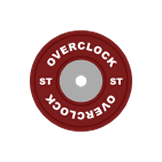

  

<h1 align="center">Overclock</h1>

A personal gym workout tracker for Android

  
  
  
  
  

---

Overclock is an Android app for lifters who want full control over their training data. Everything is stored on your device.

## Features

- **Workout logging** — quick entry with history auto-fill, a "Last time" shortcut, optional RPE, personal bests and search
- **Timer and heart rate** — lap timer that survives the app being closed; connect a Bluetooth heart rate strap for live BPM and a heart rate graph for every session
- **Sessions** — every timed workout with its heart rate, exportable as a .tcx file for Strava and other training sites
- **Progress** — streaks and a Last 30 Days comparison on Home, per-exercise stats with full history and estimated 1RM trends, a year calendar, and a weight chart with pinch zoom and a weight prediction
- **Steps** — daily step counter with a goal
- **Tools** — workout checklist, one-rep max and plate calculators, bulk exercise rename, and a running pace calculator
- **Also** — notes, Spotify and YouTube Music controls, local and Google Drive backups (Drive with Premium), a demo mode, and adjustable accent colour, brightness and font size

## Install

Download the APK from [Releases](https://github.com/SeveriT/Overclock/releases). After that, the app checks for new versions and updates itself.

## Built with

- Kotlin and Jetpack Compose (Material 3)
- Room, Navigation Compose, WorkManager
- Google Drive API, Firebase Remote Config, Google Play Billing
- Bluetooth Low Energy for heart rate straps
- Developed with help from [Claude Code](https://claude.com/claude-code), Anthropic's AI coding assistant
